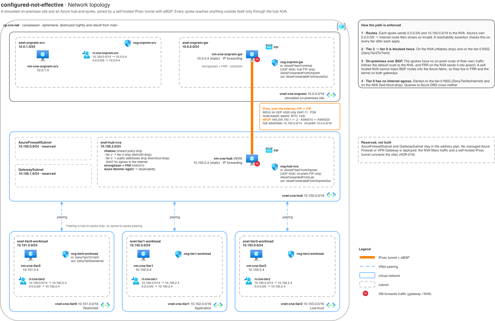
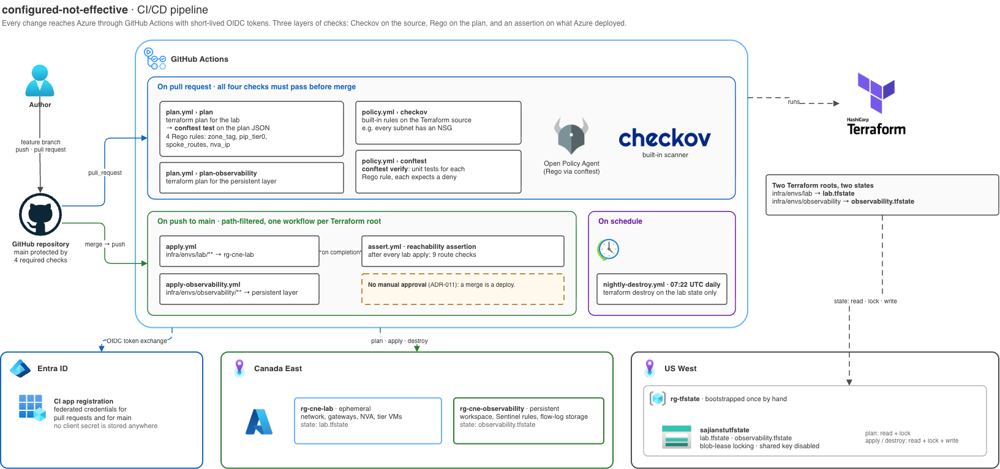
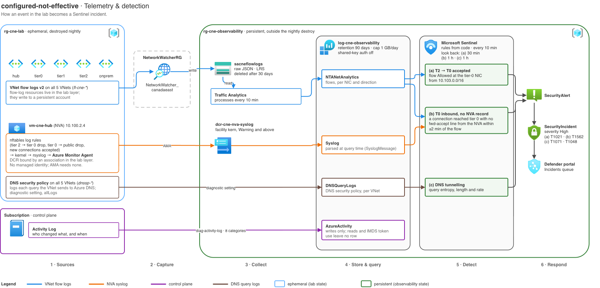

# configured-not-effective

**Validating the security posture of a hybrid cloud internetwork by attacking it, not by inspecting it.**

Cloud security controls are usually verified by reviewing their configuration. But a control can be present in the configuration and still be ineffective in practice: a security group that quietly permits every port, a route that skips the firewall, or a permitted DNS path abused for exfiltration. This project builds a trust-tiered hybrid internetwork across a simulated on-premises site and Microsoft Azure, then proves whether its controls actually hold by running attacks against them and measuring what is caught.

The guiding idea: **configured does not mean effective.** The question it answers:

> Can the security posture of a hybrid cloud internetwork be validated by attacking it rather than by inspecting it, and can the controls that fail silently be made detectable?

## Architecture

Two domains — a simulated on-premises site and Azure — joined by a self-hosted IPsec tunnel running eBGP. The on-premises site is a virtual network of its own: an edge VM (strongSwan + FRRouting) standing in for a customer edge device, and a server behind it. Azure is a hub-and-spoke of four virtual networks: a hub carrying the tunnel endpoint and the firewall, and three spokes as trust tiers (restricted, application, low-trust). The firewall is a Linux network virtual appliance (NVA) running nftables, not a managed Azure Firewall. Routing forces all inter-spoke and outbound traffic through the NVA; the restricted tier has no Internet egress, denied at both its NSG and the NVA. The lab is built from `main` and destroyed nightly; a separate persistent layer holds the logs and the detections. Everything is deployed as code and gated in CI.

See [`docs/diagrams`](docs/diagrams) for the diagrams (source: `CNE-Diagrams.drawio`) and [`docs/TECHNICAL-DESIGN.md`](docs/TECHNICAL-DESIGN.md) for the full design.

## Pipeline

1. **Prevent** — policy-as-code blocks non-compliant Terraform in CI before it deploys: Checkov on the source, Rego rules (OPA via conftest) on the plan. After every apply, a reachability assertion checks that the routes actually took effect.

2. **Detect** — detection rules as code in Microsoft Sentinel (KQL), built on Azure-native telemetry: VNet flow logs with Traffic Analytics, the NVA's nftables logs (Syslog via Azure Monitor Agent), DNS security policy query logs and the Activity Log. No third-party SIEM.

3. **Attack** — scenarios mapped to MITRE ATT&CK under an assume-breach model, each pre-registered (expected control, signal and outcome) before it runs. No Atomic Red Team test for these techniques runs on the lab's Ubuntu VMs, so every scenario is run manually through VM run-command ([ADR-023](docs/adr/ADR-023-m3-scope-and-method.md)).
4. **Validate** — for every scenario, record whether the control held and whether the failure was detected; remediate the gap, in the configuration or in a detection, and re-test.

The core output is a **before/after control-effectiveness matrix**: each attack scenario, its initial outcome, and its outcome after remediation, backed by log evidence. See [`results/control-effectiveness-matrix.md`](results/control-effectiveness-matrix.md); the runbooks are in [`attack/scenarios`](attack/scenarios) and the evidence in [`docs/evidence`](docs/evidence).

## Scope

The baseline is deliberately **one cloud**. Depth of adversarial validation is the contribution here, not provider count — a second cloud would multiply the build effort without strengthening the central claim. Address space is reserved for a second provider (`10.200.0.0/14`) and the design would mirror across, but AWS and a Kubernetes tier are not part of this project. Four scenarios are run: lateral movement from tier 2 to tier 0 (#1), a routing misconfiguration that bypasses the NVA (#3), DNS tunnelling exfiltration (#4) and credential abuse through the instance metadata service (#6). No managed VPN Gateway ([ADR-019](docs/adr/ADR-019-onprem-site.md)) or Azure Firewall is deployed. Application-layer penetration testing is out of scope: there is no production application, and this is an assume-breach test of network controls.

## Success criteria

- The repository (Terraform modules, policy-as-code rules, CI pipeline and version-controlled detections) is reproducible from its documentation alone.
- Policy-as-code blocks deliberately non-compliant changes in CI.
- Every attack scenario has a recorded initial and post-remediation outcome, backed by log evidence.
- The results state which failures can be caught deterministically and which can only be reduced.

## Stack

Terraform (azurerm, azapi) · GitHub Actions (OIDC, no long-lived keys) · Open Policy Agent (Rego via conftest) · Checkov · Azure (VNet, Linux VMs, Network Watcher flow logs and Traffic Analytics, DNS security policy, Azure Monitor Agent, Log Analytics, Microsoft Sentinel) · nftables (NVA) · strongSwan + FRRouting (IPsec, eBGP)

## License

MIT
